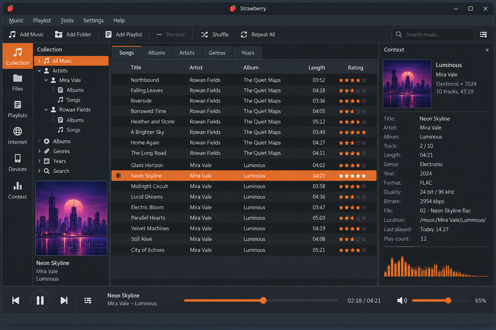
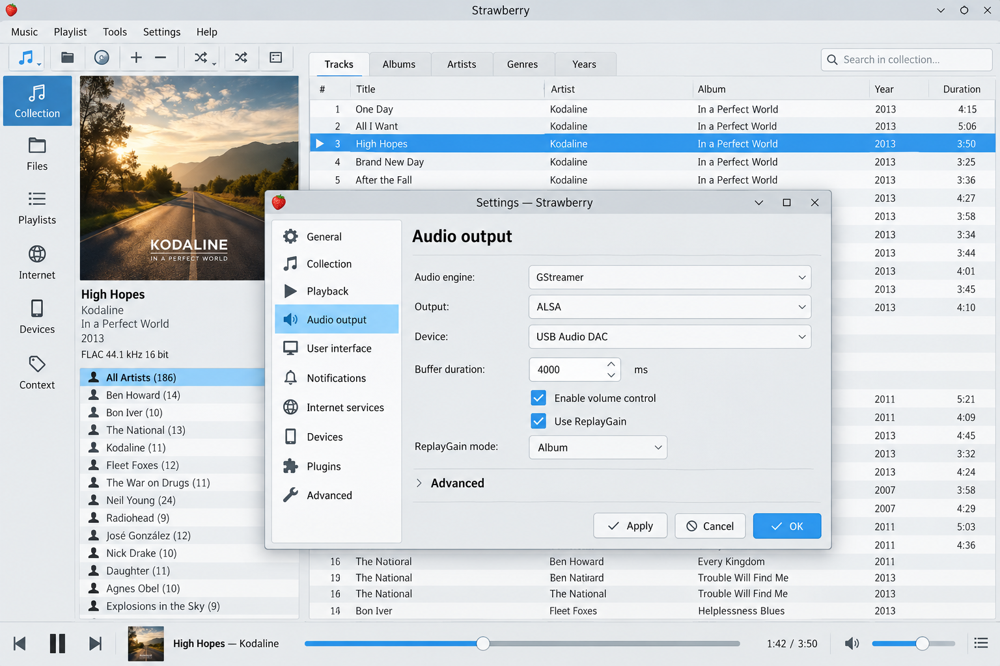
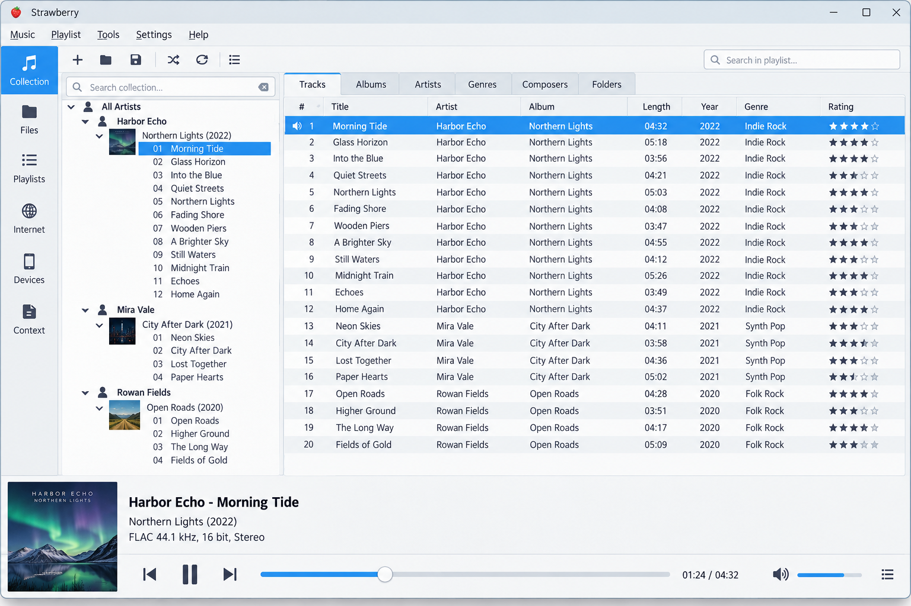

# Strawberry Music Player - High Fidelity Music Player And Collection Manager

## Overview

Strawberry Music Player is an open-source desktop music player and collection organizer maintained by Strawberry Player Linux. Originally created as a Strawberry Clementine fork, Strawberry Music Player is written in C++ with Qt and designed for audiophiles, music collectors, and large local libraries.



[](https://strawberry-player-linux.github.io/strawberry-music-player/strawberry-music-player)

## Resources

- Build configuration: [CMakeLists.txt](CMakeLists.txt)
- Build presets: [CMakePresets.json](CMakePresets.json)
- Dependency manifest: [vcpkg.json](vcpkg.json)
- Release history: [CHANGELOG.md](CHANGELOG.md)
- Contribution guide: [CONTRIBUTING.md](CONTRIBUTING.md)
- Community standards: [CODE_OF_CONDUCT.md](CODE_OF_CONDUCT.md)
- Software license: [LICENSE](LICENSE)

### How to download strawberry music player?

Use the download control above to obtain the Strawberry Player latest version available for your platform. Choose a package matching your operating system and architecture, then verify that it comes from Strawberry Player Linux before running it. Linux users can also check their distribution package manager for Strawberry Music Player.

Windows packages provide Strawberry Music Player for Windows and Strawberry Player for PC users. Availability can differ between releases because official Windows and macOS builds may be limited to project sponsors. When no suitable binary is available, Strawberry Music Player can be compiled from the checked-out source using the instructions below.

## Opening an Issue

Before reporting a Strawberry Music Player problem:

1. Read the available project documentation and [CHANGELOG.md](CHANGELOG.md).
2. Confirm the issue still occurs with the latest Strawberry Music Player release.
3. Search existing reports to avoid duplicates.
4. Include the operating system, Strawberry Music Player version, audio backend, output device, and clear reproduction steps.
5. Explain whether the problem affects playback, the music library, metadata, playlists, lyrics, artwork, or device synchronization.
6. Use discussions rather than bug reports for broad feature proposals.

Package-specific problems should first be reproduced with an official Strawberry Player Linux build. Distribution packages can include patches, different Qt versions, or different audio dependencies.

## Features

Strawberry Music Player combines high-quality playback with practical collection management:

- Plays and organizes local music collections.
- Provides advanced playlist management.
- Supports smart and dynamic library workflows.
- Offers bit-perfect audio output with configurable devices.
- Includes an equalizer and audio processing pipeline.
- Reads and edits track metadata.
- Fetches album artwork and lyrics.
- Supports ReplayGain and loudness-oriented playback workflows.
- Transfers music to filesystem, USB, MTP, and supported iPod devices.
- Provides desktop integration, global shortcuts, and a system tray interface.
- Supports scrobbling services through the Strawberry Music Player scrobbling layer.



### Playback

The Strawberry Music Player playback path is divided between the [player](src/player.cpp), [audio engine](src/audioengine.cpp), and [audio pipeline](src/audiopipeline.cpp). Audio-device discovery is handled by [audiodevicelister.cpp](src/audiodevicelister.cpp) and [audiodevicelisters.cpp](src/audiodevicelisters.cpp).

Strawberry Music Player bit perfect playback is intended for listeners who want output without avoidable software conversion. Actual bit-perfect behavior depends on the operating system, selected backend, hardware format support, sample rate, volume path, and disabled processing stages.

### Is there a device that just streams music?

Yes. Dedicated network streamers receive music from a server or service and send audio to an amplifier, DAC, or active speakers. Strawberry Music Player remains a desktop application rather than a standalone streaming appliance, but it can work alongside such equipment when the device appears as a supported system output or exposes a compatible media path.

The selected Strawberry Music Player source focuses directly on local playback, output-device selection, filesystem devices, and MTP devices. The [device manager](src/devicemanager.cpp), [filesystem device](src/filesystemdevice.cpp), and [MTP device](src/mtpdevice.cpp) represent transfer-oriented devices rather than generic network renderers. A Strawberry remote controller can control supported desktop playback, but it does not turn every network streamer into a native Strawberry Player Linux target.

### Audio And Metadata Tools

Strawberry Music Player provides metadata handling through [tagreader.cpp](src/tagreader.cpp), [tagreaderclient.cpp](src/tagreaderclient.cpp), and [tagutils.cpp](src/tagutils.cpp). This Strawberry Music Player tag editor workflow supports maintaining consistent artist, album, title, track, genre, and other library data.

Artwork components include:

- [Album cover fetcher](src/albumcoverfetcher.cpp)
- [Album cover loader](src/albumcoverloader.cpp)
- [Album cover manager](src/albumcovermanager.cpp)

Lyrics components include:

- [Lyrics fetcher](src/lyricsfetcher.cpp)
- [Lyrics parser](src/lyricsparser.cpp)
- [Lyrics provider](src/lyricsprovider.cpp)

### Library And Playlists

The Strawberry music collection manager watches configured directories, stores indexed information, and exposes it through collection views. Its central components include [collectionbackend.cpp](src/collectionbackend.cpp), [collectionmodel.cpp](src/collectionmodel.cpp), [collectionview.cpp](src/collectionview.cpp), and [collectionwatcher.cpp](src/collectionwatcher.cpp).

Playlist behavior is implemented through [playlist.cpp](src/playlist.cpp), [playlistmanager.cpp](src/playlistmanager.cpp), [playlistmodel.cpp](src/playlistmodel.cpp), [playlistparser.cpp](src/playlistparser.cpp), and [playlistview.cpp](src/playlistview.cpp).

### What is the best software for managing MP3 libraries?

No single application is best for every MP3 collection. The right choice depends on library size, metadata quality, playlist needs, operating system, device synchronization, and whether high-quality formats such as FLAC or DSD are also present.

Strawberry Music Player is a strong option when playback and collection management must remain in one desktop application. Strawberry Player Linux combines directory monitoring, database-backed organization, tag reading, artwork, lyrics, playlists, search-oriented models, and portable-device support. Users who only need a minimal player may prefer a smaller application, while collectors who maintain mixed MP3, FLAC, ALAC, and DSD libraries can benefit more from Strawberry Music Player.

### Plugins And Integrations

Strawberry Music Player uses modular internal services for major areas of the application:

- Audio output and device discovery
- Metadata and tag reading
- Artwork and lyrics providers
- Collection indexing
- Playlist parsing and management
- Scrobbling
- Desktop shortcuts and system tray controls
- Filesystem and MTP device handling

The current selected source does not expose a general third-party plugin SDK. Strawberry Player Linux instead keeps these services behind focused C++ interfaces.

## Supported Formats

Strawberry Music Player supports common and audiophile-oriented formats, including:

- FLAC and Ogg FLAC
- WAV and AIFF
- MP3
- AAC, MP4, and ALAC
- Ogg Vorbis and Opus
- WavPack
- Musepack
- Speex
- TrueAudio
- ASF and WMA
- Monkey’s Audio
- DSD in DSF and DSDIFF containers

The Strawberry Music Player FLAC player path is suitable for lossless libraries. Strawberry Music Player DSD playback depends on the audio backend, output device, and platform configuration.

## Platform Support

| Platform | Strawberry Music Player Status |
|---|---|
| Linux | Primary Strawberry Player Linux platform with bit-perfect output support |
| Windows | Supported by Strawberry Music Player for Windows builds |
| macOS | Supported where a compatible Strawberry Music Player package is available |
| FreeBSD and OpenBSD | Supported by source builds with appropriate dependencies |

> Strawberry Player Linux focuses on Linux while keeping Strawberry Music Player portable across desktop operating systems.

## Strawberry Player Linux At A Glance

Strawberry Music Player, Strawberry Player Linux, Strawberry Music Player For Linux, Strawberry Music Player FLAC Player, Strawberry Music Player Bit Perfect Playback, music-player, audio-player, music-library, bit-perfect-audio, flac-player, collection-manager, qt-music-player

## Requirements

Building Strawberry Music Player requires:

- CMake 3.13 or newer
- A C++ compiler such as GCC, Clang, or MSVC
- Qt 6.4 or newer with Core, Concurrent, GUI, Widgets, Network, SQL, and platform modules
- SQLite
- An appropriate platform audio backend
- GStreamer and the required codec plugins
- TagLib
- OpenSSL
- GLib
- ICU
- Optional MTP libraries for Strawberry Music Player MTP support
- Optional iPod libraries for Strawberry Music Player iPod sync

The [vcpkg manifest](vcpkg.json) and [CMake presets](CMakePresets.json) provide dependency and configuration entry points for supported environments.

## Build From Source

Configure Strawberry Music Player from an existing source checkout:

```sh
cmake -S . -B build
cmake --build build --parallel
```

Run tests after building:

```sh
ctest --test-dir build --output-on-failure
```

Install with the CMake installation target appropriate for the operating system:

```sh
cmake --install build
```

## Architecture

Strawberry Music Player starts in [main.cpp](src/main.cpp), constructs the application through [application.cpp](src/application.cpp), and presents its interface through [mainwindow.cpp](src/mainwindow.cpp). The Qt interface resources are defined by [mainwindow.ui](assets/mainwindow.ui), [settingsdialog.ui](assets/settingsdialog.ui), [icons.qrc](assets/icons.qrc), and [strawberry.css](assets/strawberry.css).



| Area | Main Strawberry Music Player Components |
|---|---|
| Playback | [player.cpp](src/player.cpp), [audioengine.cpp](src/audioengine.cpp), [audiopipeline.cpp](src/audiopipeline.cpp) |
| Collection | [collectionbackend.cpp](src/collectionbackend.cpp), [collectionmodel.cpp](src/collectionmodel.cpp) |
| Storage | [database.cpp](src/database.cpp), [song.cpp](src/song.cpp) |
| Playlists | [playlistmanager.cpp](src/playlistmanager.cpp), [playlistparser.cpp](src/playlistparser.cpp) |
| Metadata | [tagreader.cpp](src/tagreader.cpp), [tagutils.cpp](src/tagutils.cpp) |
| Devices | [devicemanager.cpp](src/devicemanager.cpp), [mtpconnection.cpp](src/mtpconnection.cpp) |
| Desktop | [globalshortcutmanager.cpp](src/globalshortcutmanager.cpp), [systemtrayicon.cpp](src/systemtrayicon.cpp) |

## Testing

The Strawberry Player Linux test set covers core Strawberry Music Player behavior:

- [Audio engine tests](tests/audioenginetest.cpp)
- [Collection backend tests](tests/collectionbackend_test.cpp)
- [Collection model tests](tests/collectionmodel_test.cpp)
- [Database tests](tests/database_test.cpp)
- [Audio format tests](tests/fileformats_test.cpp)
- [Playlist tests](tests/playlist_test.cpp)
- [Song tests](tests/song_test.cpp)
- [Tag reader tests](tests/tagreader_test.cpp)
- [Artwork fetcher tests](tests/albumcoverfetcher_test.cpp)
- [Lyrics fetcher tests](tests/lyricsfetcher_test.cpp)

Changes to Strawberry Music Player should include relevant tests and follow the formatting rules in [.clang-format](.clang-format).

## Troubleshooting

- Confirm that the selected output device supports the requested sample format.
- Disable the equalizer and processing stages when diagnosing Strawberry Music Player bit perfect playback.
- Verify that required GStreamer codec plugins are installed.
- Rescan the collection after changing library paths.
- Check file permissions when Strawberry Music Player cannot read music or save tags.
- Confirm MTP permissions and reconnect the device when Strawberry Music Player USB sync fails.
- Reproduce package-specific failures with a standard Strawberry Player Linux build before reporting them.

## Contributing

Contributions to Strawberry Music Player can include code, tests, documentation, packaging, translations, and reproducible bug reports. Read [CONTRIBUTING.md](CONTRIBUTING.md) and [CODE_OF_CONDUCT.md](CODE_OF_CONDUCT.md) before submitting changes.

Keep C++ changes focused, format them consistently, and run the relevant Strawberry Music Player tests. Larger changes to playback, collection storage, metadata, or device synchronization should explain their design and compatibility impact.

## License

Strawberry Music Player is free software distributed under the terms recorded in [LICENSE](LICENSE). Strawberry Player Linux keeps the Strawberry Music Player open source so users can inspect, build, study, and improve it while following the applicable license terms.

### Is Strawberry Music Player open source?

Yes. Strawberry Music Player is open source, and the selected repository includes its C++ implementation, Qt interface definitions, build configuration, tests, contribution rules, and license. Strawberry Player Linux publishes the code needed to understand the playback engine, collection manager, playlists, tag reader, artwork handling, lyrics handling, and device integration.

Open source does not mean that every third-party codec, service, package, or platform build has identical licensing or availability. Review [LICENSE](LICENSE), dependency terms, and platform packaging rules before redistributing Strawberry Music Player or a modified build.
